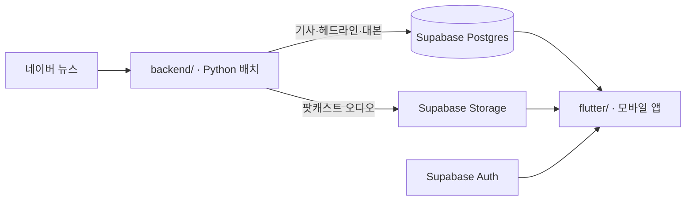

# Briefly

한국어 뉴스를 모아 주요 이슈를 정리하고, 두 진행자가 대화하는 팟캐스트로 만드는 개인 프로젝트입니다.
Python 배치가 콘텐츠를 생성해 Supabase에 저장하고, Flutter 앱이 기사·브리핑·오디오를 읽습니다.
오전·오후 브리핑을 생성하는 구조이며, 정기 실행은 사용자가 별도로 등록합니다.

- **뉴스 피드**: 정치·경제·사회·문화·국제·IT/과학 6개 카테고리의 기사와 주요 헤드라인
- **통합 브리핑**: 정치·경제·국제의 주요 토픽을 엮은 대본과 오디오. 목표 분량은 8~10분
- **모바일 앱**: 뉴스 탐색·검색·기사 상세·팟캐스트 재생, Kakao/Google 로그인과 게스트 모드

[구조](#구조) · [설치](#설치) · [실행](#실행) · [검증](#검증) · [문제 해결](#문제-해결) · [보존 자료](#현재-범위와-보존-자료)

## 구조

`backend/`는 한 번 실행한 뒤 종료하는 **로컬 배치 CLI**입니다.
앱은 Supabase를 직접 사용하므로 별도의 Briefly HTTP 서버를 실행할 필요가 없습니다.



배치는 다음 순서로 동작합니다.

1. 네이버 기사 수집 → KURE-v1 임베딩 → 중복 제거 → UMAP/HDBSCAN 클러스터링
2. 토픽 순위와 대표 기사를 `news_cards`에 저장하고, Ollama Gemma4로 헤드라인을 생성해 `headlines`에 저장
3. 하드뉴스 3분야의 주요 토픽으로 OpenAI 대본 생성 → NotebookLM 오디오 생성 → `podcasts`와 Storage에 저장

대본에는 기사 출처 태그를 사용하며, 숫자 대조와 문장 후처리를 수행합니다.
Discord 알림과 Grafana Loki 계측은 선택적으로 연결할 수 있습니다.

| 구성 | 주요 기술 |
|---|---|
| 수집·분석 | Python 3.12, httpx, BeautifulSoup, sentence-transformers, UMAP, HDBSCAN |
| 생성 | KURE-v1, Ollama `gemma4:e4b-it-q4_K_M`, OpenAI `gpt-5.4`, `notebooklm-py` |
| 데이터·인증 | Supabase Postgres, Storage, Auth |
| 앱 | Flutter, Riverpod, go_router, just_audio |

```text
Briefly/
├── backend/
│   ├── app/tasks/scheduler.py    # 배치 진입점
│   ├── app/services/            # 수집·분석·생성·저장
│   ├── app/db/migrations/       # DB 초기화·변경 SQL
│   ├── test/                   # 수동 검증 CLI와 fixtures/
│   ├── .env.example
│   └── requirements.txt
├── flutter/
│   ├── lib/                    # 앱 화면·상태·데이터 조회
│   ├── android/                # Android 프로젝트
│   ├── ios/                    # iOS 프로젝트
│   ├── .env.example
│   └── pubspec.yaml
└── docs/                       # 디자인·실험·과거 구현 기록
```

## 설치

### 준비할 것

| 실행 범위 | 필요한 환경 |
|---|---|
| 공통 | Git, 본인 소유의 Supabase 프로젝트 |
| 배치 | Python 3.12, Ollama, 모델을 저장할 디스크 공간. GPU 사용 권장 |
| 대본 생성 | OpenAI API 키와 모델 사용 권한 |
| 오디오 생성 | NotebookLM을 사용할 Google 계정과 브라우저 로그인 |
| 앱 | [Flutter SDK](https://docs.flutter.dev/install), Dart `>=3.11.5 <4.0.0`을 만족하는 버전 |
| Android | Android SDK와 에뮬레이터 또는 실제 기기. `flutter doctor`로 도구 확인 |
| iOS | macOS, Xcode, 시뮬레이터 또는 실제 기기 |

이미 콘텐츠가 있는 Supabase에 앱만 연결하려면 Python·Ollama·생성용 API 키 없이 Flutter 설정부터 진행할 수 있습니다.
새 프로젝트에는 콘텐츠가 없으므로 기사·오디오를 보려면 배치를 실행해야 합니다.
OpenAI 호출과 외부 서비스 사용에는 계정별 비용·한도가 적용됩니다.

### 1. 저장소 받기

```bash
git clone https://github.com/kk53451/Briefly.git
cd Briefly
```

### 2. Supabase 준비

**새 프로젝트**의 SQL Editor에서 [마이그레이션 폴더](backend/app/db/migrations/)의 다음 파일을 순서대로 실행합니다.
기존 DB에서는 적용 이력을 먼저 확인하세요. 초기 스키마와 일부 ALTER 문은 반복 실행용이 아닙니다.

1. [0001_init_schema.sql](backend/app/db/migrations/0001_init_schema.sql)
2. [0002_rls_policies.sql](backend/app/db/migrations/0002_rls_policies.sql)
3. [0003_storage_bucket.sql](backend/app/db/migrations/0003_storage_bucket.sql)
4. [0005_rename_frequencies_to_podcasts.sql](backend/app/db/migrations/0005_rename_frequencies_to_podcasts.sql)
5. [0007_add_podcast_title_and_covered_keywords.sql](backend/app/db/migrations/0007_add_podcast_title_and_covered_keywords.sql)
6. [0008_add_podcast_duration_sec.sql](backend/app/db/migrations/0008_add_podcast_duration_sec.sql)
7. [0009_add_news_cards_hero_image.sql](backend/app/db/migrations/0009_add_news_cards_hero_image.sql)
8. [0010_add_news_cards_keywords.sql](backend/app/db/migrations/0010_add_news_cards_keywords.sql)

`0004`와 `0006`은 이전 오디오 정리 작업입니다. `storage.objects`를 SQL로 직접 삭제하는 구현이어서 이 기본 설치 순서에서는 제외합니다.
오디오 보관 기간 자동화는 [Storage API를 사용하는 방식](https://supabase.com/docs/guides/storage/management/delete-objects)으로 별도 보완해야 합니다.

그다음 Data API를 활성화하고 `public` 스키마가 노출 대상인지 확인한 뒤, 다음 권한을 적용합니다.
[테이블 접근 권한과 RLS](https://supabase.com/docs/guides/api/securing-your-api)는 함께 필요합니다. RLS 정책은 위의 `0002`에 있습니다.

```sql
grant usage on schema public to anon, authenticated, service_role;

grant select on public.news_cards, public.headlines, public.podcasts
  to anon, authenticated;
grant select, insert, update on public.news_cards, public.headlines, public.podcasts
  to service_role;
grant select, update on public.profiles to authenticated;
grant select, insert, delete on public.bookmarks to authenticated;
```

설치 후 데이터 구조는 다음과 같습니다.

| 테이블·버킷 | 용도 |
|---|---|
| `news_cards` | 대표 기사, 카테고리, 날짜·슬롯, 순위, 이미지, 본문·키워드 |
| `headlines` | 카테고리별 브리핑. 헤드라인 배열은 `items`에 저장 |
| `podcasts` | 날짜·슬롯별 통합 브리핑. `script`, `audio_path`, `title`, `duration_sec`, `covered_keywords` |
| `profiles` | 가입 시 생성되는 프로필, 관심사, 온보딩 완료 여부 |
| `bookmarks` | 북마크용 테이블. 앱 저장 기능 연결은 미완성 |
| `briefly-audio` | 공개 오디오 버킷. `{date}/briefing_AM.mp3` 또는 `briefing_PM.mp3` 저장 |

앱은 `audio_path`로 Storage 공개 URL을 만듭니다. 버킷 이름은 현재 앱 코드와 맞춰 `briefly-audio`를 사용하세요.

로그인 기능을 사용하려면 다음도 설정합니다.

- Supabase Auth에서 사용할 [Kakao](https://supabase.com/docs/guides/auth/social-login/auth-kakao)·[Google](https://supabase.com/docs/guides/auth/social-login/auth-google) provider를 활성화하고 OAuth 앱 정보를 등록합니다.
- Supabase의 허용 redirect URL에 `briefly://auth-callback`을 추가합니다. Kakao 개발자 콘솔의 redirect URI에는 Supabase가 표시하는 `https://<project-ref>.supabase.co/auth/v1/callback`을 사용합니다.
- Google 네이티브 로그인은 플랫폼별 앱 식별자·인증서·클라이언트 ID 설정도 필요합니다. 앱의 기본 식별자는 `com.briefly.briefly`입니다.

### 3. 백엔드 준비

저장소 루트에서 아래 **OS에 맞는 블록 하나**를 실행합니다. 기존 `.env`가 있다면 복사 단계를 생략하세요.

**Windows PowerShell**

```powershell
cd backend
py -3.12 -m venv venv
.\venv\Scripts\Activate.ps1
Copy-Item .env.example .env
```

**macOS / Linux**

```bash
cd backend
python3.12 -m venv venv
source venv/bin/activate
cp .env.example .env
```

이후 명령은 활성화된 가상환경과 `backend/` 디렉터리를 기준으로 합니다.
CUDA를 사용할 경우 [PyTorch 설치 안내](https://pytorch.org/get-started/locally/)에서 GPU·드라이버에 맞는 패키지를 먼저 설치하세요.

```bash
python -m pip install --upgrade pip
python -m pip install -r requirements.txt "notebooklm-py==0.4.1"
```

이 안내는 현재 코드가 사용하는 `DEFAULT_STORAGE_PATH` 등을 확인한 `notebooklm-py 0.4.1`을 지정합니다.
`requirements.txt`는 여러 패키지에 최소 버전만 지정하므로 전체 환경이 고정된 lockfile은 아닙니다.

[backend/.env.example](backend/.env.example)을 참고해 `backend/.env`에 값을 입력합니다.

| 변수 | 용도 |
|---|---|
| `SUPABASE_URL` | 사용할 프로젝트의 `https://<project-ref>.supabase.co` 주소 |
| `SUPABASE_SERVICE_ROLE_KEY` | 배치 쓰기용 **legacy `service_role` JWT 키** |
| `SUPABASE_AUDIO_BUCKET` | `briefly-audio` 유지 |
| `OPENAI_API_KEY` | 대본 생성·평가에 사용하는 키 |
| `OPENAI_MODEL`, `OPENAI_JUDGE_MODEL` | 기본 예시 `gpt-5.4`. 계정에서 사용할 모델로 설정 |
| `DISCORD_WEBHOOK_URL`, `DISCORD_PIPELINE_WEBHOOK_URL` | 선택: 오류·진행 알림. 미설정 시 알림 생략 |
| `GRAFANA_LOKI_URL`, `GRAFANA_LOKI_USER`, `GRAFANA_LOKI_TOKEN` | 선택: Loki 계측. 사용할 때 `.env`에 추가 |

현재 [백엔드 키 검증](backend/app/utils/supabase_client.py)은 JWT 형식만 받습니다.
따라서 이 코드에서는 `sb_secret_...` 대신 legacy `service_role` 키를 사용합니다. 키 종류는 [Supabase API 키 안내](https://supabase.com/docs/guides/getting-started/api-keys)를 참고하세요.
이 키는 백엔드에만 두고 Flutter `.env`에는 넣지 마세요.

**로컬 모델 준비**

[Ollama](https://docs.ollama.com/quickstart)를 설치하고 실행한 뒤, 코드에서 사용하는 모델을 받습니다.

```bash
ollama pull gemma4:e4b-it-q4_K_M
ollama list
```

Ollama 서버가 실행 중이 아니라면 별도 터미널에서 `ollama serve`를 실행합니다.
현재 주소와 모델명은 [headline_service.py](backend/app/services/headline_service.py)의 `OLLAMA_BASE_URL`, `OLLAMA_MODEL` 상수입니다.
KURE-v1 임베딩 모델은 첫 사용 시 내려받으며, CUDA 사용 여부는 `python -c "import torch; print(torch.cuda.is_available())"`로 확인할 수 있습니다.

**오디오 생성용 로그인**

```bash
python -m playwright install chromium
notebooklm login
```

브라우저에서 Google 로그인을 마친 뒤 터미널 안내에 따라 인증을 저장합니다.
배치를 실행할 OS 사용자 계정에서 진행하세요. Linux에서 브라우저 시스템 라이브러리가 부족하면 `python -m playwright install-deps chromium`이 추가로 필요할 수 있습니다.
`notebooklm-py`는 비공식 클라이언트이며, 인증이 만료되면 다시 로그인해야 합니다. [프로젝트 설치 안내](https://github.com/teng-lin/notebooklm-py/blob/main/docs/installation.md)
오디오를 생략하는 `--skip-podcast` 또는 `--skip-script` 실행에는 이 로그인 단계가 필요하지 않습니다.

### 4. Flutter 준비

**새 터미널의 저장소 루트**에서 시작합니다.

```bash
cd flutter
flutter doctor
flutter pub get
```

`flutter/.env.example`을 `flutter/.env`로 복사합니다. PowerShell은 `Copy-Item .env.example .env`, macOS/Linux는 `cp .env.example .env`를 사용합니다.
기존 `.env`가 있으면 덮어쓰지 말고 확인하세요. 템플릿에 프로젝트 값이 들어 있어도 **본인의 Supabase 값으로 교체**합니다.

| 변수 | 용도 |
|---|---|
| `SUPABASE_URL` | 백엔드와 같은 프로젝트 URL |
| `SUPABASE_ANON_KEY` | 앱용 publishable 키 또는 legacy anon 키 |
| `GOOGLE_WEB_CLIENT_ID` | Google 로그인용 Web 클라이언트 ID |
| `GOOGLE_IOS_CLIENT_ID` | iOS Google 로그인용 클라이언트 ID. Android만 개발할 때는 생략 가능 |

`.env`는 앱 asset에 포함됩니다. 서버 비밀 키를 넣으면 앱에 함께 배포됩니다.
Kakao 딥링크와 오디오 백그라운드 설정은 이미 플랫폼 파일에 있으며, 자세한 위치는 [Flutter 안내](flutter/README.md)에 있습니다.

## 실행

### 백엔드

`backend/`에서 가상환경을 활성화한 상태로 실행합니다.
아래 명령은 실제 기사를 수집하고 Supabase에 데이터를 저장합니다. 같은 날짜·슬롯의 콘텐츠는 갱신될 수 있습니다.

```bash
# 처음에는 경제 피드만 생성해 수집·모델·DB 연결 확인
python -X utf8 -m app.tasks.scheduler --categories economy --skip-script

# 전체 6개 카테고리 피드 + 통합 대본, 오디오 생략
python -X utf8 -m app.tasks.scheduler --time-slot morning --skip-podcast

# 전체 피드 + 통합 대본 + 오디오
python -X utf8 -m app.tasks.scheduler --time-slot morning
python -X utf8 -m app.tasks.scheduler --time-slot afternoon
```

| 옵션 | 동작 |
|---|---|
| `--time-slot morning` / `afternoon` | 오전/오후 지정. 생략하면 KST 정오를 기준으로 자동 선택 |
| `--categories economy politics` | 수집할 카테고리 제한. 선택한 하드뉴스로 브리핑도 생성될 수 있음 |
| `--skip-script` | 피드만 생성. 대본·오디오 생략 |
| `--skip-podcast` | 대본까지 생성. 오디오 생략 |

정치·경제·국제는 브리핑 대상이며, 사회·문화·IT/과학은 피드만 생성합니다.
실행 결과 JSON·대본·오디오는 `backend/outputs/`, 임베딩 캐시는 `backend/data/embedding_cache/`에 저장됩니다.
상세 옵션은 `python -X utf8 -m app.tasks.scheduler --help`에서 확인할 수 있습니다.

### 앱

`flutter/`에서 실행합니다.

```bash
flutter devices
flutter run -d <device-id>
```

새 DB는 배치가 콘텐츠를 저장하기 전까지 빈 화면을 표시할 수 있습니다. 홈·오늘 화면은 KST 날짜 기준 데이터를 사용합니다.
현재 플랫폼은 Android/iOS이며, 웹 프로젝트는 포함되어 있지 않습니다.
Android APK는 `flutter build apk --release`로 만들 수 있지만, 현재 release 설정은 debug 서명을 사용하므로 배포 전 서명 구성이 필요합니다.

### 정기 실행

`scheduler.py` 자체에는 상시 대기하는 타이머가 없습니다. 수동 실행을 확인한 뒤 cron 또는 작업 스케줄러에 등록합니다.
아래는 **시간대가 Asia/Seoul인 Linux 호스트**의 사용자 crontab 예시입니다. `/home/you/Briefly`를 실제 절대 경로로 바꾸고 `backend/logs/`를 먼저 만드세요.

```cron
0 5 * * * cd /home/you/Briefly/backend && /home/you/Briefly/backend/venv/bin/python -X utf8 -m app.tasks.scheduler --time-slot morning >> /home/you/Briefly/backend/logs/pipeline.log 2>&1
0 16 * * * cd /home/you/Briefly/backend && /home/you/Briefly/backend/venv/bin/python -X utf8 -m app.tasks.scheduler --time-slot afternoon >> /home/you/Briefly/backend/logs/pipeline.log 2>&1
```

Windows 작업 스케줄러에서는 프로그램을 `backend\venv\Scripts\python.exe`의 절대 경로로,
인수를 `-X utf8 -m app.tasks.scheduler --time-slot morning` 또는 `afternoon`으로,
시작 위치를 `backend`의 절대 경로로 지정합니다. 실행 계정에서 Ollama와 NotebookLM 인증을 사용할 수 있어야 합니다.

## 검증

배치의 `test/`는 외부 서비스와 모델을 사용하는 **수동 검증 CLI 모음**입니다.
처음에는 `backend/`에서 도움말로 실행 환경을 확인하세요.

```bash
python -X utf8 -m app.tasks.scheduler --help
python -X utf8 -m test.generate_integrated_briefing_dryrun --help
python -X utf8 -m test.transcribe_and_evaluate --help
```

저장된 뉴스 샘플로 대본만 생성하려면 다음을 실행합니다. 로컬 임베딩과 OpenAI 호출이 발생하고 결과는 `test/results/`에 저장됩니다.

```bash
python -X utf8 -m test.generate_integrated_briefing_dryrun --time-slot morning
```

오디오 재생성·전사·DB 쓰기 스모크 테스트의 영향과 추가 의존성(`faster-whisper`, `ffprobe`)은 [검증 도구 안내](backend/test/README.md)에 정리했습니다.
앱 정적 분석은 `flutter/`에서 `flutter analyze`로 실행합니다. 앱 동작을 검증하는 Dart 자동 테스트는 아직 없습니다.

## 문제 해결

| 증상 | 확인할 것 |
|---|---|
| `No module named app` 또는 `.env`를 못 찾음 | `backend/`에서 실행했는지, 가상환경이 활성화됐는지 확인 |
| `SUPABASE_SERVICE_ROLE_KEY` 형식 오류 | backend에 legacy JWT 키를 넣었는지 확인. 현재 검증기는 `sb_secret_...`를 받지 않음 |
| DB에서 `permission denied` / `42501` | Data API 노출과 테이블 GRANT, RLS 정책 확인 |
| 앱에 기사가 없음 | 앱·배치가 같은 프로젝트를 사용하는지, 오늘 KST 날짜의 `news_cards`·`headlines`가 있는지 확인 |
| Ollama 연결 실패 또는 모델 없음 | 서버 실행 여부, `ollama list`, 코드의 모델 상수 확인 |
| 임베딩이 매우 느림 | PyTorch CUDA 사용 여부와 첫 모델 다운로드 상태 확인 |
| 대본만 있고 오디오가 없음 | `--skip-podcast` 사용 여부, NotebookLM 재로그인, 생성·업로드 오류 로그 확인 |
| 모델 교체 후 임베딩 차원 오류 | 현재 캐시 키에 모델명이 포함되지 않으므로 기존 임베딩 캐시를 별도로 보관한 뒤 새로 생성 |
| 로그인 후 앱으로 돌아오지 않음 | Supabase redirect URL과 플랫폼 OAuth 설정, Google 클라이언트 ID 확인 |

## 현재 범위와 보존 자료

현재 구현에는 뉴스 피드·통합 대본·오디오 생성과 앱 조회·재생 흐름이 있습니다.
북마크 저장, 프로필 활동 지표, 배포 서명과 자동 테스트는 추가 작업이 필요합니다.
기사 수집 시간 윈도우는 `BRIEFING_WINDOW_ENABLED = False`로 꺼져 있고, 지정 슬롯은 브리핑 라벨과 저장 구분에 사용합니다.

- [문서 목록](docs/README.md)
- [디자인 원본과 화면 기록](docs/design/README.md)
- [실험·평가 기록](docs/research/README.md)
- [과거 구조와 기술 선택](docs/history/README.md)
- [DEPRECATED 구현·보존 태그·복구 방법](docs/DEPRECATED.md)

현재 `backend/`는 Supabase 배치입니다. 과거 FastAPI 서버와 React Native·Next.js 구현은 보존 태그에서 확인할 수 있습니다.
과거 문서의 코드·지표·명령은 작성 당시의 기록입니다.

## 라이선스

MIT License.
