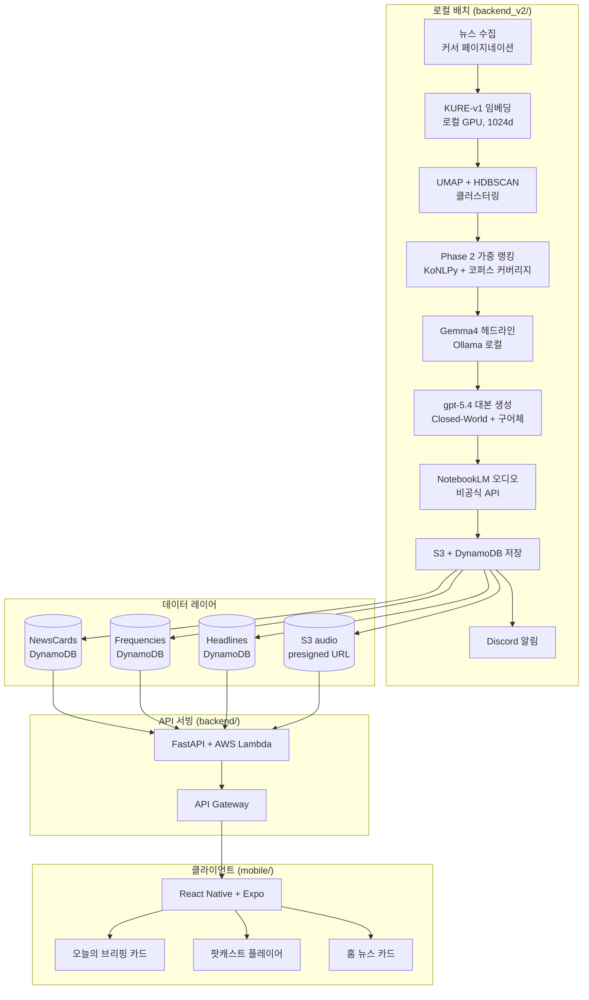

# Briefly — AI 뉴스 팟캐스트 플랫폼

> **과거 설계 입력 자료**: 프로토타입 제작 당시 업로드한 README 원본입니다.
> 본문의 AWS·React Native 구성과 실행 명령은 종료된 구현을 설명합니다.
> 현재 사용법은 [루트 README](../../../../README.md), 옛 소스는 [보존 태그](../../../DEPRECATED.md)를 참고하세요.

**한국어 뉴스를 AI가 큐레이션하고, 대화형 팟캐스트로 만들어 하루 두 번(오전/오후) 전달하는 개인 프로젝트.**

[](https://www.python.org/)
[](https://fastapi.tiangolo.com/)
[](https://reactnative.dev/)
[](https://aws.amazon.com/)
[](https://openai.com/)
[](https://notebooklm.google.com/)
[](https://ollama.com/)

---

## 개요

매일 뉴스를 수집해 AI 큐레이션을 거쳐 팟캐스트 오디오로 만드는 엔드투엔드 자동화 파이프라인. **배치 처리(로컬)** + **API 서빙(AWS Lambda)** + **모바일 앱(React Native)** 의 3계층 구조.

### 특징

- **10단계 자동 파이프라인** — 뉴스 수집부터 오디오 배포까지 무인 운영
- **Phase 2 가중 토픽 랭킹** — size / corpus coverage / press diversity 3축 가중 평가로 그날의 주요 이슈 선별
- **로컬 임베딩 + 로컬 LLM** — KURE-v1(임베딩)과 Gemma4(헤드라인)로 비용 $0
- **정통 뉴스 방송 톤 팟캐스트** — gpt-5.4가 생성한 앵커/해설 2인 대본을 NotebookLM이 오디오로 변환
- **오전/오후 2회 브리핑** — DynamoDB PK 에 `AM`/`PM` 슬롯을 포함하여 시간대별 구분
- **Discord 실시간 모니터링** — 파이프라인 단계별 알림을 2채널(alerts / pipeline)로 분리

---

## 아키텍처



---

## 10단계 파이프라인

| # | 단계 | 구현 | 비고 |
|---|---|---|---|
| 1 | **뉴스 수집** | `naver_news_service.py` | 커서 기반 페이지네이션으로 카테고리당 최대 1,000건 |
| 2 | **임베딩** | `embedding_service.py` | KURE-v1 (한국어 특화, 1024d). GPU 사용 후 언로드 |
| 3 | **Near-duplicate 제거** | `clustering_service.py` | cosine similarity 0.95 임계값 |
| 4 | **UMAP + HDBSCAN 클러스터링** | `clustering_service.py` | 동적 mcs, 거대 클러스터 fallback |
| 5 | **Phase 2 가중 토픽 랭킹** | `clustering_service.py` | `0.25·size + 0.60·corpus + 0.15·diversity` |
| 6 | **오늘의 브리핑 헤드라인** | `headline_service.py` | Ollama Gemma4 로컬 — 친근체 요약 생성 |
| 7 | **비례 배분 소스 풀** | `clustering_service.py` | 토픽당 최소 6건, 총 50건 풀 |
| 8 | **gpt-5.4 대본 생성** | `script_service.py` | Closed-World + Source-Tagged + VOICE TEXTURE |
| 9 | **NotebookLM 오디오 생성** | `notebooklm_service.py` | v2 instructions, TTS 숫자 전처리, 오전/오후 슬롯 |
| 10 | **S3 + DynamoDB 저장** | `storage_service.py` | 3개 테이블에 병렬 쓰기, presigned URL 7일 |

### 품질 검증
- **Closed-World 프롬프트** — 소스 기사에 없는 내용은 금지
- **Source-Tagged 대본** — `[S1]...[SN]` 태그로 모든 사실 주장을 추적
- **규칙 기반 숫자 검증** — 대본의 수치를 원본 기사에서 직접 grep
- **후처리** — 연속 화자 병합, 메타언어 탐지, 숫자 과밀 경고

## 데이터 모델

### DynamoDB

**Frequencies** — 팟캐스트 대본 + 오디오 URL
- PK: `frequency_id = {category}#{date}#{slot}` (예: `economy#2026-04-17#AM`)
- Fields: `script`, `audio_url`, `category`, `date`, `slot`, `created_at`

**Headlines** — 오늘의 브리핑 카드 (AI 큐레이션)
- PK: `category_date = {category}#{date}#{slot}`
- Fields: `headlines` (JSON: topic_id, headline, summary, cluster_size, representative_title/image/press, keywords)

**NewsCards** — 홈 탭 기사 카드 (클러스터 대표기사)
- PK: `news_id` (oid+aid 기반)
- GSI: `category_date-index`
- Fields: `title`, `images`, `provider`, `rank` (1~20), `cluster_size`, `content`, `published_at`

**Users** (현재 미사용 — 게스트 모드)
- PK: `user_id`

### S3

```
briefly-news-audio/
└── news-audio/
    └── {date}/
        └── shared/
            ├── economy_AM.mp3
            ├── economy_PM.mp3
            ├── politics_AM.mp3
            └── ...
```

---

## 기술 스택

### 배치 파이프라인 (`backend_v2/`)
- **Python 3.12**, FastAPI 없음 (CLI 스케줄러)
- **임베딩**: `sentence-transformers` + KURE-v1 (로컬 GPU)
- **클러스터링**: `umap-learn` + `hdbscan`
- **형태소 분석**: `konlpy` (Okt) + JPype + JDK 17
- **LLM**:
  - 대본 — OpenAI `gpt-5.4` (reasoning_effort=high)
  - 헤드라인 — Ollama `gemma4:e4b-it-q4_K_M` (로컬)
- **오디오**: `notebooklm-py` (비공식 API, 쿠키 기반 자동 인증)
- **저장**: `boto3` (S3, DynamoDB)
- **알림**: Discord 웹훅 2채널

### API 서빙 (`backend/`)
- **FastAPI** + AWS Lambda (Mangum) + API Gateway
- **인증**: 현재 게스트 모드 (Kakao 제거, JWT 선택적 검증)
- **DynamoDB 클라이언트**: boto3

### 모바일 앱 (`mobile/`)
- **React Native** 0.81 + **Expo** SDK 54
- **네비게이션**: `@react-navigation/bottom-tabs` + stack
- **오디오**: `expo-av`
- **상태**: React Context (Auth / Theme / AudioPlayer)
- **TypeScript** 5.9

### 외부 서비스
| 서비스 | 용도 | 비용 |
|---|---|---|
| OpenAI gpt-5.4 | 대본 생성 | ~$75/월 (6 카테고리 × 2회/일) |
| NotebookLM | 오디오 생성 | 무료 (비공식 API) |
| | 뉴스 수집 | 무료 (스크래핑) |
| KURE-v1 | 임베딩 | 무료 (로컬) |
| Gemma4 | 헤드라인 | 무료 (로컬) |
| AWS S3 | MP3 저장 | ~$0.11/월 |
| AWS DynamoDB | 메타데이터 | Free Tier 내 |
| Discord | 알림 | 무료 |

---

## 프로젝트 구조

```
Briefly/
├── backend_v2/                   # 배치 파이프라인 (로컬 실행)
│   ├── app/
│   │   ├── services/
│   │   │   ├── naver_news_service.py      # 1. 수집
│   │   │   ├── embedding_service.py       # 2. 임베딩 + unload
│   │   │   ├── clustering_service.py      # 3~5. 클러스터링 + 랭킹
│   │   │   ├── headline_service.py        # 6. Gemma4 헤드라인
│   │   │   ├── script_service.py          # 8. gpt-5.4 대본
│   │   │   ├── script_postprocess.py      #    대본 후처리
│   │   │   ├── notebooklm_service.py      # 9. 오디오
│   │   │   ├── storage_service.py         # 10. S3 + DynamoDB
│   │   │   ├── notify_service.py          #     Discord
│   │   │   └── engines/                   #     LLM 엔진 추상화
│   │   ├── tasks/
│   │   │   └── scheduler.py               # 메인 오케스트레이터
│   │   ├── constants/category_map.py
│   │   └── utils/date.py                  # KST + 오전/오후 슬롯
│   ├── test/                     # 실험/검증 스크립트
│   └── requirements.txt
│
├── backend/                      # API 서빙 (AWS Lambda)
│   ├── app/
│   │   ├── routes/
│   │   │   ├── headlines.py              # /api/headlines (slot 지원)
│   │   │   ├── frequency.py              # /api/frequencies (slot)
│   │   │   ├── news.py                   # /api/news/today, /home
│   │   │   ├── auth.py                   # /api/auth/guest
│   │   │   └── user.py, category.py, ...
│   │   ├── utils/
│   │   │   ├── dynamo.py                 # DynamoDB CRUD
│   │   │   ├── jwt_service.py            # 게스트 JWT
│   │   │   └── date.py
│   │   └── main.py
│   ├── template.yaml             # AWS SAM
│   └── requirements.txt
│
├── mobile/                       # 사용자 앱 (React Native + Expo)
│   ├── src/
│   │   ├── screens/
│   │   │   ├── TodayScreen.tsx           # 오늘의 브리핑 (AM/PM 토글)
│   │   │   ├── HomeScreen.tsx            # 카테고리별 뉴스
│   │   │   ├── PodcastScreen.tsx         # 팟캐스트 플레이어
│   │   │   ├── ProfileScreen.tsx
│   │   │   ├── LoginScreen.tsx           # 게스트 모드
│   │   │   ├── OnboardingScreen.tsx
│   │   │   └── NewsDetailScreen.tsx
│   │   ├── components/
│   │   │   ├── HeadlineCard.tsx          # 풀스크린 스와이프 카드
│   │   │   ├── HorizontalNewsCard.tsx
│   │   │   ├── TopNewsCard.tsx
│   │   │   └── NewsImage.tsx
│   │   ├── contexts/                     # Auth / Theme / AudioPlayer
│   │   ├── services/api.ts               # API 클라이언트
│   │   ├── types/api.ts
│   │   └── navigation/                   # Root / Main / Stack
│   ├── app.config.js
│   └── package.json
│
├── frontend/                     # (과거 Next.js 웹, 현재 비사용)
├── CLAUDE.md                     # Claude Code 작업 가이드
└── README.md
```

---

## 시작하기

### 요구사항
- **Python 3.12**, **Node.js 20+**
- **CUDA GPU** (KURE-v1 / Gemma4 로컬 추론용)
- **Ollama** (`gemma4:e4b-it-q4_K_M` 설치 필요)
- **JDK 17** (KoNLPy용)
- **AWS 자격증명** (S3 + DynamoDB 쓰기 권한)
- **OpenAI API 키**
- **NotebookLM 구글 계정 쿠키** (`notebooklm login`)
- **Discord 웹훅 URL** 2개 (alerts / pipeline)

### 배치 파이프라인 실행

```bash
cd backend_v2
pip install -r requirements.txt

# 6개 카테고리 전체 실행 (~3-5시간, 대본+오디오 포함)
python -m app.tasks.scheduler

# 특정 카테고리만
python -m app.tasks.scheduler --categories economy politics

# 오디오 건너뛰기 (대본만)
python -m app.tasks.scheduler --categories economy --skip-podcast
```

### API 서버 (로컬 개발)

```bash
cd backend
pip install -r requirements.txt
uvicorn app.main:app --reload --port 8000
# API 문서: http://localhost:8000/docs
```

### AWS Lambda 배포

```bash
cd backend
sam build
sam deploy --guided  # 최초 1회
sam deploy           # 이후
```

### 모바일 앱

```bash
cd mobile
npm install
npx expo prebuild --platform android --clean
npx expo run:android  # Android Studio 에뮬레이터 필요
# 또는
npx expo run:ios      # Xcode 필요 (Mac)
```

### 환경 변수 (`.env`)

```bash
# OpenAI
OPENAI_API_KEY=sk-proj-...
OPENAI_MODEL=gpt-5.4

# AWS
AWS_DEFAULT_REGION=ap-northeast-2
S3_BUCKET=briefly-news-audio
DDB_FREQ_TABLE=Frequencies
DDB_HEADLINES_TABLE=Headlines
DDB_NEWS_TABLE=NewsCards
DDB_USERS_TABLE=Users
DDB_BOOKMARKS_TABLE=Bookmarks

# Discord 알림
DISCORD_WEBHOOK_URL=https://discord.com/api/webhooks/.../...         # alerts 채널
DISCORD_PIPELINE_WEBHOOK_URL=https://discord.com/api/webhooks/.../... # pipeline 채널

# JWT (게스트 모드)
JWT_SECRET=dev-secret-change-in-prod
```

---

## 현재 상태 (2026-04-18 기준)

### ✅ 완료
- 6개 카테고리(경제/정치/사회/문화/국제/IT과학) 전체 파이프라인 검증 완료 (BROADCAST_READY)
- 오늘의 브리핑 자동 생성 (Gemma4 로컬, 비용 $0)
- NotebookLM 오디오 생성 + 자동 인증 갱신
- S3 + DynamoDB 저장 (슬롯 기반 PK)
- Discord 실시간 모니터링 (34개 웹훅 포인트)
- 모바일 앱 v2 데이터 연동 (AM/PM 토글, HeadlineCard)

### 🚧 진행 중
- 스포츠 카테고리 스크래퍼 (Sports가 SPA라 별도 처리 필요)
- Windows Task Scheduler / Ubuntu cron 자동화 등록
- 본격 인증 수단 (이메일, Google, Apple — 현재는 게스트 모드)

### 💡 개선 여지
- 프론트엔드 UI 재설계 (Claude Design 활용 검토 중)
- Phase 2 랭킹 파라미터 튜닝
- 오디오 TTS 한국어 숫자 처리 (현재는 전처리로 완화)

---

## 라이선스

MIT License.
