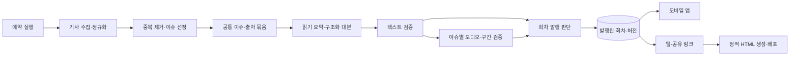

# BRIEFLY 전체 리비전 — 제품·BI·기술 설계 초안

작성일: 2026-10-23 (KST) · 상태: 방향 합의 반영, 구현 전 설계 초안

현재 BI 작업은 [새 브랜드·디자인 시스템 v0.1](briefly-v2/README.md)이다. `frontend-design`을 적용해 BI와 토큰부터 정의하고 모바일 첫 화면을 웹으로 확장했다. 이전 [세 방향 프로토타입](bi-exploration/README.md)은 탐색 기록으로 보존한다.

## 1. 합의된 방향

- BI, 백엔드 파이프라인, 프론트엔드와 기술 스택을 함께 재설계한다.
- 핵심 경험은 **읽기와 듣기가 연결된 짧은 데일리 브리핑**이다.
- **모바일 앱과 웹을 함께** 제공한다.
- **클라우드 자동 운영, 낮은 초기 비용**을 우선한다.

이 문서의 기술 선택은 위 조건에 대한 제안이다. 개별 프레임워크·공급자·디자인 시안까지 확정된 것은 아니다. 기존 작업 트리의 변경은 보존한다.

현재 코드의 구체적인 근거와 미완성 항목은 [현행 진단](CURRENT_STATE.md)에 기록했다. 이번 작업은 코드·문서 검토이며, 배포나 유료 API 호출을 수행한 결과가 아니다.

## 2. 제품을 정의하는 단위

**한 회차의 브리핑 안에서 핵심 이슈를 읽고, 같은 이슈를 듣고, 원문 출처를 확인한다.**

내부의 중심 단위를 `Edition`(브리핑 회차)으로 바꾼다. 기사 피드·헤드라인·팟캐스트가 각각 독립적으로 오늘을 표현하던 구조를, 발행 시각과 이슈 구성이 명확한 회차로 연결한다.

초기 분량 가설은 회차당 핵심 이슈 3~5개, 읽기 1~2분, 듣기 약 5분이다. 이는 제품 검증용 목표이며, 현재 구현의 분량이나 사용자와 확정한 약속이 아니다. 카테고리별 할당량보다 이슈의 중요성과 근거를 우선한다. 스포츠 제외는 기존 프로젝트 제약으로 유지한다.

주요 사용 흐름:

1. 로그인 없이 최신 발행 회차와 실제 발행 시각을 확인한다.
2. 요약을 읽거나 전체 듣기를 시작한다.
3. 이슈 카드의 듣기를 누르면 해당 이슈의 오디오 구간으로 이동한다.
4. 듣는 중에도 같은 이슈의 요약·근거·출처로 돌아올 수 있다.
5. 이어 듣기·저장·지난 회차를 통해 다음 방문으로 연결한다.

공통 핵심 이슈를 먼저 제공하고, 개인화는 탐색·관심 주제·저장부터 적용한다. 사용자별 개별 오디오 생성은 초기 운영비와 검증 범위를 늘리므로 후속 후보로 둔다.

## 3. BI 작업 범위와 후보

작업명은 BRIEFLY를 유지한다. 네이밍 변경 여부는 아직 정하지 않았다. 브랜드의 약속 초안은 **“오늘의 맥락을 짧게, 읽고 듣다.”**다.

| 방향 | 시각·언어 | 제품과의 연결 | 확인할 점 |
|---|---|---|---|
| 차분한 데일리 저널 — 우선 탐색안 | 종이·잉크 계열, 절제된 한 가지 포인트, 한글 본문 가독성, 간결한 편집 | 읽기의 신뢰감과 회차의 일관성 | 현재 세리프·크림색 자산을 어디까지 계승할지 |
| 가벼운 데일리 라디오 | 명료한 산세리프, 작은 리듬·재생 모티프, 친근하고 짧은 문장 | 이동 중 듣기와 반복 방문 | 오디오 강조가 읽기 경험을 가리지 않는지 |
| 명료한 브리핑 도구 | 중립색, 정보 위계, 시각·길이·출처가 눈에 들어오는 구성 | 빠른 이해와 완료감 | 지나치게 업무용 대시보드처럼 느껴지지 않는지 |

산출물은 포지셔닝·브랜드 문장·톤 가이드, 워드마크·심벌·앱 아이콘, 한영 타이포그래피, 색·간격·모션 토큰, 오디오 표지, 핵심 화면의 라이트·다크 적용이다. AI 사용 여부는 투명하게 설명하되, 서비스가 주는 효용을 먼저 전달한다.

브랜드 시안은 같은 브리핑 샘플로 비교한다. 모바일 첫 화면과 데스크톱 첫 화면을 함께 보고, 긴 한국어 제목·이미지 없는 이슈·글자 확대에서도 확인한다. 실제 생성 시간이 검증되기 전에는 “매일 몇 시”, “정확히 몇 분”을 확정 카피로 사용하지 않는다.

## 4. 프론트엔드 스택 제안

**우선 검증 후보: TypeScript + React Native/Expo + Expo Router.** 모바일·웹의 도메인 모델, 데이터 조회, 회차 이동을 공유하고, 화면 배치와 오디오 처리는 플랫폼에 맞게 구성한다.

| 선택지 | 장점 | 비용·한계 | 이번 조건에서의 위치 |
|---|---|---|---|
| Expo 모바일·웹 통합 | 하나의 제품 코드에서 모바일과 웹을 함께 개발. 공개 회차의 정적 HTML 생성 가능 | Flutter 화면·상태를 이식해야 함. 네이티브 로그인·오디오·웹 배치별 검증 필요 | 우선 기술 검증 |
| Flutter 유지 + 별도 웹 | 기존 앱 자산을 많이 활용하고 웹은 문서 중심으로 구성 가능 | Dart와 웹 프론트엔드를 함께 유지. 기능·BI 적용이 두 구현에 걸침 | 이식 비용이 크거나 기존 앱 완성도가 중요할 때 대안 |
| Flutter + Flutter Web | 앱 코드 재사용 범위가 큼 | 공개 브리핑의 검색 노출·문서형 읽기 경험을 별도로 풀어야 함 | 웹이 로그인형 앱에 가까울 때 대안 |

Flutter 공식 문서는 텍스트 중심 정적 페이지와 SEO의 한계를 설명한다. 공개 브리핑을 검색·공유 가능한 웹 콘텐츠로 제공하려는 이번 제안에서는 이 차이가 중요하다. [Flutter Web FAQ](https://docs.flutter.dev/platform-integration/web/faq)

Expo Router의 정적 렌더링은 빌드 시 HTML을 생성한다. 새 회차 URL은 발행 후 웹 빌드·배포에 포함되어야 하며, 동적 경로가 자동으로 생긴다고 가정하지 않는다. 초기에는 발행 완료 이벤트와 정적 배포를 연결하고, 아카이브가 커질 때 렌더링 전략을 재평가한다. [Expo 정적 렌더링](https://docs.expo.dev/router/web/static-rendering/)

오디오는 `expo-audio`를 먼저 검증한다. 플랫폼 지원이 있다는 것과 동일한 동작을 보장한다는 것은 다르므로, Android/iOS 백그라운드·잠금 화면, 웹의 사용자 재생 시작·탭 이동을 각각 확인한다. [Expo Audio](https://docs.expo.dev/versions/latest/sdk/audio/)

이식 착수 기준은 **실제 샘플 1회차로 웹 직접 링크 → 읽기 → 구간 듣기, 모바일 백그라운드 재생, 인증 복귀**를 검증하는 것이다. 통과 전에는 기존 Flutter를 제거하지 않는다. 과거 폐기한 Expo 구현을 그대로 복원하지 않고 현재 요구사항으로 판단한다.

## 5. 클라우드 파이프라인 제안

**Python 배치 + Cloud Run Jobs + Cloud Scheduler + Supabase**를 초기 기준안으로 둔다. 정해진 시각에 컨테이너를 실행하고 종료하는 구조다. Google Cloud는 Cloud Scheduler로 Cloud Run Job을 예약 실행하는 방법을 제공한다. 실제 계정·리전·예산은 배포 설계 단계에서 정한다. [예약 실행 문서](https://docs.cloud.google.com/run/docs/execute/jobs-on-schedule)

| 영역 | 제안 | 선택 이유·검증 조건 |
|---|---|---|
| Python 실행 환경 | 현행 Python 3.12를 기준으로 재현 가능한 패키징, uv·pyproject·lock 검토 | 배치·평가·로컬 모델 의존성을 분리하고 새 환경에서 재현 |
| 수집 | 공급자별 어댑터, 기사 식별자·수집 시각·출처 보존 | 기존 네이버 수집기를 활용하되 클라우드 네트워크에서 수집 가능성과 실패 처리를 검증 |
| 임베딩·클러스터링 | 임베딩 API와 소형 CPU 모델 비교, 현행 클러스터링을 평가 기준으로 보존 | 상시 GPU 전제를 없애고 한국어 이슈 분리 품질·실행 비용·지연을 함께 측정 |
| 텍스트 생성 | 공급자 교체 가능한 호출 경계, 구조화된 회차·이슈 출력 | 헤드라인·요약·대본이 같은 근거 묶음을 사용 |
| 오디오 생성 | 공식 API 기반 TTS/대화 생성 후보 평가 | 한국어 발음, 대본 충실도, 이슈 구간 생성, 비용을 검증 후 선택 |
| 실행 제어 | 작업·단계 결과를 영속화, 재시도 상한·중복 실행 방지·실패 종료 코드 | 저장 실패를 성공으로 기록하지 않고 성공한 유료 단계 재실행을 줄임 |
| 데이터·인증·오디오 | Supabase Postgres·Auth·Storage 유지 후보 | 신규 발행 모델과 읽기 계약 도입. 실제 프로젝트 상태·권한·비용은 별도 확인 |
| 계측 | 회차·실행 ID별 시간, 비용, 실패·품질 결과 | 기존 계측을 활용하되 운영자가 성공·부분 성공·실패를 구분 가능하게 함 |

uv는 프로젝트 메타데이터와 lockfile을 통해 의존성 관리를 제공한다. CPU·GPU 환경의 패키지 차이까지 자동으로 해결된다고 가정하지 않고 대상 환경별 설치를 검증한다. [uv 프로젝트 구조](https://docs.astral.sh/uv/concepts/projects/layout/)

NotebookLM은 비교용 품질 기준으로 남길 수 있지만, 현재 사용하는 `notebooklm-py`는 비공식 클라이언트다. 브라우저 인증 복구가 필요한 경로는 무인 운영의 기본 오디오 경로에서 분리하는 안을 제안한다. [프로젝트 설명](https://github.com/teng-lin/notebooklm-py)

Prefect는 워커·실행 인프라 연결이 필요해질 때 검토할 후보다. 초기 두 번의 예약 배치에서는 별도 오케스트레이션 플랫폼을 바로 추가하기보다, 영속 단계 결과와 재실행 정책부터 구현한다. [Prefect Work pools](https://docs.prefect.io/v3/concepts/work-pools)

## 6. 회차 중심의 데이터·발행 구조

개념 모델 초안:

| 단위 | 책임 |
|---|---|
| SourceArticle | 원문 식별자·URL·매체·발행/수집 시각·본문 해시 |
| Edition / EditionRevision | 서비스 날짜·회차·기준 시각·현재 발행 버전·발행 상태 |
| EditionTopic | 회차 내 순서·헤드라인·요약·근거 기사 연결·오디오 구간 연결 |
| AudioArtifact / Segment | 회차 버전·대본 해시·파일 경로·실측 길이·구간 시작/종료·준비 상태 |
| PipelineRun / StageResult | 실행·입력 해시·엔진/프롬프트 버전·재시도·비용·결과·오류 |
| 사용자 저장·재생 위치 | 사용자와 안정적인 콘텐츠 ID의 연결 |

원문 기사 ID와 회차 내 카드 ID를 분리한다. 같은 기사가 다음 회차에도 등장해도 이전 회차의 구성이 바뀌지 않아야 한다. 발행 버전별 오디오 경로도 분리해 재실행이 이미 공개된 파일을 덮어쓰지 않게 한다.

초기 발행 정책 제안은 **텍스트 준비 완료 후 읽기 공개, 검증된 오디오는 같은 회차 버전에 후속 연결**이다. 오디오가 없으면 “오디오 준비 중”을 표시하고, 해당 회차에 이전 회차의 오디오를 섞지 않는다. 오디오 실패 시 기존 발행본을 보존한다. 내용 수정은 새로운 회차 버전을 만들고 출처·대본·오디오의 대응을 재검증한다.

구간 시각은 실제 생성 파일 길이 또는 검증한 정렬 결과에서 계산한다. 대본 글자 수로 임의 추정해 카드 재생 위치를 만들지 않는다. 초기 오디오 엔진 검증에서 이슈별 생성·결합과 전체 생성 후 정렬의 품질 차이를 비교한다.

발행 포인터의 전환은 DB 트랜잭션으로 처리하고, 앱은 발행된 버전만 읽는다. 동시 실행은 회차별 실행 잠금과 소유권 검증으로 제어한다. 중간 생성물·실행 기록은 공개 읽기 대상에서 분리한다. Supabase의 테이블 접근 권한과 행 단위 RLS를 함께 설계한다. [Data API 보안](https://supabase.com/docs/guides/api/securing-your-api)

이는 SQL 마이그레이션이 아닌 설계 초안이다. 실제 스키마와 마이그레이션 이력을 확인한 뒤 필요한 테이블·제약·조회 인덱스를 확정한다.

## 7. 화면 구조 제안

| 영역 | 모바일 | 웹 |
|---|---|---|
| 오늘 | 회차 표지, 실제 발행 시각, 전체 듣기, 핵심 이슈 | 읽기와 플레이어를 함께 볼 수 있는 반응형 배치 |
| 이슈 | 요약·출처·이 구간 듣기 | 직접 접근 가능한 URL, 공유 메타데이터, 문서형 읽기 |
| 지난 브리핑·탐색 | 회차 목록·검색·관심 주제 | 회차 아카이브·검색·주제 탐색 |
| 저장·설정 | 저장 목록·이어 듣기·글자 크기·테마 | 같은 계정 데이터, 키보드·스크린리더 접근 |
| 공통 재생 | 탭 이동에도 유지되는 미니 플레이어 | 페이지 이동에도 유지되는 플레이어 |

현재 홈과 투데이의 역할을 다시 정리하고, 첫 진입은 데일리 브리핑에 둔다. 로그인은 저장·동기화가 필요한 순간에 제안한다. 알림은 발행 신뢰성이 검증된 후 연결한다.

공통 상태는 로딩, 발행 전, 발행 지연, 텍스트만 준비, 오디오 준비/실패, 최신 회차가 오래됨, 네트워크 오류로 구분한다. 최신 회차 대체 표시에는 실제 날짜와 시각을 보여준다.

## 8. 실행 순서와 완료 조건

| 단계 | 산출물 | 다음 단계로 넘어가는 조건 |
|---|---|---|
| 0. 현행 기준 확보 | 현행 진단, 대표 기사·대본·오디오 평가 샘플, 주요 결함 목록 | 샘플의 품질·처리 시간·비용을 기록하고 미측정 항목을 구분 |
| 1. 제품·BI | 포지셔닝, BI 3개 비교 시안, 모바일·웹 핵심 흐름, 범위 | 같은 샘플로 읽기·듣기 연결과 가독성을 비교해 방향 선택 |
| 2. 기술 검증 | Expo 핵심 흐름, 오디오 후보 비교, 클라우드 배치 실행, 비용표 | 웹 직접 링크·모바일 재생·무인 실행·예산 기준 충족 |
| 3. 공통 데이터와 파이프라인 | 회차 계약, 출처 연결, 재실행·발행 상태, 단계별 결과 | 저장 실패·중복 실행·오디오 실패에도 기존 발행본 보존 |
| 4. 모바일·웹 통합 | 오늘→읽기→구간 듣기→출처→저장, 인증·설정 | 정상/빈/오류 상태, 글자 확대, 실기기 재생, 웹 접근성 검증 |
| 5. 발행·배포 전환 | 반복 예약 실행 기록, 앱 배포 설정, 웹 발행 연결, 운영 절차 | 합의한 발행 시각·품질·비용 충족, 복구·롤백 검증 |

첫 구현 단위는 **샘플 1회차의 완결된 읽기·듣기 흐름**이다. 전체 화면을 먼저 늘리지 않고 이 흐름으로 BI, 데이터 계약, 오디오 기술을 함께 검증한다.

이행은 신규 계약·별도 산출물로 비교 실행 → 기존 클라이언트 호환 확인 → 신규 화면 연결 → 발행 경로 전환 순서로 진행한다. 기존 테이블·Flutter 구현 제거는 사용 중인 경로가 없는지 확인한 뒤 별도 단계로 다룬다.

## 9. 비용과 검증 기준

월 비용은 `회차 수 × 회차당 수집·추론·오디오 비용 × 재시도 계수 + 실행 인프라 + DB/스토리지 + 오디오 전송량 + 웹 빌드·호스팅 + 모바일 빌드·배포 관련 비용`으로 나눠 기록한다. 무료 구간이나 모델 가격만으로 전체 비용을 판단하지 않는다.

상한을 두는 항목은 수집 기사 수, 소스 길이, 모델 출력 길이, 오디오 분량, 단계별 재시도 횟수, 동시 실행 수다. 같은 입력·엔진·프롬프트의 검증된 결과는 재사용한다. 클라우드 예산 알림과 실제 호출 차단 정책은 구분해 설계한다.

측정 항목은 발행 지연·실패, 잘못 합쳐진 이슈와 중복 이슈, 근거 없는 주장·숫자 오류, 읽기/오디오의 내용 불일치, 재생 성공과 구간 이동, 회차당 원가다. 자동 평가와 실제 한국어 청취 검토를 함께 사용한다. 목표 수치는 기준 샘플 측정 후 정한다.

아직 결정할 사항:

- 주요 이용자와 사용 순간: 출퇴근, 아침 확인, 점심 정리 등.
- 월 운영비 상한과 예상 초기 이용량.
- 하루 발행 횟수·목표 시각·실제 듣기 길이.
- 브랜드명 유지 여부와 BI 시안 선택.
- 웹의 검색 유입·공유 중요도, 북마크·개인화·알림의 첫 릴리스 범위.
- 실제 사용할 클라우드 계정·오디오 공급자·운영 프로젝트.

이 항목은 이후 설계·평가에서 순서대로 결정한다. 위에서 합의한 제품 방향을 다시 확인받기 위한 목록은 아니다.
